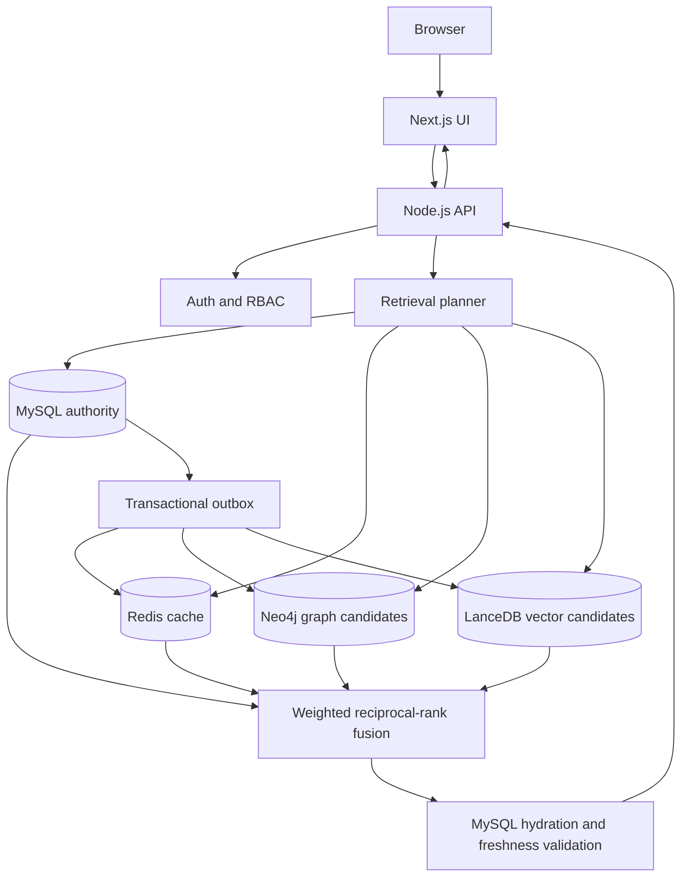

# PolyFind Architecture

## Approved stack and deployment shape

PolyFind is a Next.js + Node.js + TypeScript modular monolith. The UI and API are separate processes in development and are packaged together for the Docker app service.

| Concern | Technology | Authority / role |
|---|---|---|
| Web UI | Next.js, React, TypeScript | Search, product details, customer login/registration, admin workspace |
| Transactional catalogue | MySQL 8 | Sole authority for product/offer facts, prices, stock, versions, users, sessions, audit and outbox |
| Cache | Redis | Derived read cache and reverse invalidation indexes |
| Relationship retrieval | Neo4j 5 Community | Derived product/category/brand/seller/variant/offer graph and candidate IDs |
| Vector retrieval | LanceDB | Embedded persistent vector index and candidate IDs |
| Embeddings | Local deterministic feature hashing by default | Lexical vector baseline; optional separately configured OpenAI-compatible provider |
| Orchestration | Node.js/TypeScript API | Retrieval planning, weighted fusion, authoritative hydration and freshness checks |

Qdrant is excluded. No microservices, payment/order workflows, retailer scraping, or paid cloud dependencies are part of the approved scope.

## Runtime topology

## Data ownership and schema responsibilities

MySQL owns:
- products, categories, brands and canonical product versions;
- sellers, product variants, offers and offer price history;
- users, role assignments, hashed session tokens and expiry/revocation state;
- audit records whose actor identity is derived from the authenticated principal;
- transactional outbox events and per-target delivery state.

Redis, Neo4j and LanceDB are derived stores. They may contribute candidate identifiers, ranks, and version metadata. They never become authoritative for price, stock, product identity, or account state.

## Search request path

1. The API validates query text, structured filters, pagination and freshness mode.
2. The planner selects MySQL keyword retrieval and, when hybrid retrieval is enabled and available, vector and graph candidate providers.
3. Provider results are combined using weighted reciprocal-rank fusion. Default contribution weights are MySQL 0.50, vector 0.35, and graph 0.15; these are explicit engineering defaults, not learned or empirically optimized values.
4. Candidate identifiers are batch-hydrated from MySQL.
5. Candidate source versions are compared with authoritative MySQL versions. Missing, stale, or unverifiable candidates are classified explicitly.
6. Only candidates marked safe to present are returned. Product fields in the response are taken from MySQL, not from Redis, Neo4j, or LanceDB.
7. A search response is cached only when its freshness status is verified. Cache entries carry version snapshots and product reverse indexes.

### Freshness modes

- **Strict:** stale, missing-version, or unverifiable candidates are rejected. If the authority cannot verify a candidate, it is not presented.
- **Best effort:** stale candidates may contribute ranking when an authoritative MySQL product can still be hydrated; the response is marked degraded. Transactional fields shown to the user still come from MySQL.
- A non-verified search response indicates derived-candidate staleness/unverifiability, not necessarily that a stale price or stock value was displayed. The benchmark records this status separately from its narrative interpretation.

## Write and synchronization path

1. An administrator mutation is authorized and validated.
2. MySQL commits the catalogue change, increments the relevant version, records audit information and writes outbox events in the same transaction.
3. The outbox worker claims target deliveries using leases and retries transient failures with bounded backoff; exhausted deliveries enter a dead-letter state.
4. Redis invalidation and Neo4j/LanceDB projection updates are idempotent and version-aware.
5. MySQL remains available as the source of truth if any derived store is degraded or unavailable.

Seed generation is deterministic and additive. It does not overwrite existing products or categories. CI migrations and benchmark seeding are restricted to a disposable database named `polyfind_test`; existing local or production databases and Docker volumes are not part of automated acceptance.

## Authentication and authorization

- Public search and product browsing do not require an account.
- Customers can register and sign in but cannot mutate shared catalogue data.
- The first administrator is created through a one-time bootstrap token.
- Passwords are stored as scrypt hashes; random session tokens are stored as hashes with expiry and revocation.
- Browser sessions use an HttpOnly, SameSite=Strict cookie; the API adds Secure in production. Bearer tokens remain supported for API clients.
- The API can reject mutation requests from a disallowed Origin when an explicit origin is configured. Production deployment must verify HTTPS, allowed-Origin configuration and CSRF behavior.
- Login, registration and bootstrap throttling is process-local. Horizontally scaled deployment requires a shared limiter.

## Main API surface

| Method | Path | Purpose |
|---|---|---|
| GET | `/api/health` | Liveness and dependency status |
| GET | `/api/ready` | Readiness |
| GET | `/api/products` | Authoritative catalogue listing, filters, sorting and pagination |
| GET | `/api/products/:id` | Authoritative product detail |
| POST | `/api/search` | Keyword/vector/graph retrieval, fusion and freshness validation |
| GET/POST | `/api/offers` | List and administrator-create seller offers |
| PATCH | `/api/offers/:id` | Version-checked offer update and price history |
| GET | `/api/price-history` | Offer price history |
| POST | `/api/auth/register` | Customer registration |
| POST | `/api/auth/login` | Session login |
| POST | `/api/auth/bootstrap` | One-time administrator creation |
| POST | `/api/auth/logout` | Session revocation |
| GET | `/api/auth/me` | Current authenticated principal |

Catalogue mutation endpoints require the administrator role. Client-supplied actor IDs are not trusted.

## Repository modules

- `src/catalog`: MySQL pool, migrations, repositories, relational entities and deterministic seed generation.
- `src/api`: HTTP server, request validation, search orchestration and API response contracts.
- `src/auth`: password hashing, sessions, role checks and bootstrap lifecycle.
- `src/cache`: Redis adapter, cache keys, TTLs and reverse invalidation.
- `src/retrieval`: keyword, graph and vector providers, embeddings and LanceDB lifecycle.
- `src/fusion`: weighted reciprocal-rank fusion and deterministic ranking.
- `src/planner`: query routing and freshness validation.
- `src/sync`: transactional outbox, Neo4j projection and derived-store delivery.
- `src/benchmark`: seeded workloads, repeated-run measurements, relevance metrics and artifacts.
- `web`: Next.js pages, components and browser API/auth clients.
- `scripts`: development/startup, migration, seed and disposable benchmark entry points.

## Operational modes and limitations

- **Demo mode:** deterministic in-memory catalogue; useful for UI development, but does not prove real-store integration.
- **Live local Docker mode:** MySQL, Redis and Neo4j run as Compose services; LanceDB persists in a named volume.
- **CI mode:** service containers and temporary LanceDB paths are disposable. The benchmark runner refuses databases other than `polyfind_test`.
- **Public hosting:** not certified until the deployed commit, database migrations, persistent storage, readiness and authentication are independently smoke-tested.

The local feature-hashing vectorizer is lexical rather than transformer-based. Fusion weights are not optimized. Relevance labels are manually checked against the seed-42 catalogue but still need independent annotator review before research claims. Synthetic data limits external validity. Process-local throttling is not sufficient for horizontal scale.

## Evidence and decision records

- [13-phase master acceptance](./13_PHASE_MASTER_ACCEPTANCE.md)
- [Final implementation and evaluation report](./FINAL_REPORT.md)
- [Relevance evaluation methodology](./RELEVANCE_EVALUATION_METHODOLOGY.md)
- [MySQL authority decision](./decisions/ADR-001-mysql-authority.md)
- [Freshness validation decision](./decisions/ADR-005-freshness-validation-and-safe-fallback.md)
