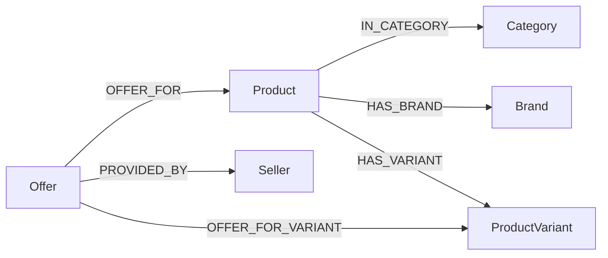

# Neo4j Graph Schema and Synchronization Semantics

Neo4j is a derived projection of MySQL. It is reconstructable from the
relational records and never owns price, stock, authentication, or offer
history facts. The real adapter is
[`Neo4jGraphAdapter`](../src/sync/neo4j-driver.ts), while
`Neo4jGraphSyncAdapter` remains an explicit in-memory test double.

## 1. Graph model

Every node stores the originating MySQL identifier as `sourceId`; names and
slugs are not graph identity.

| Label | Source table | Stored projection |
|---|---|---|
| `Product` | `products` | `sourceId`, `name`, `sourceVersion`, `status` |
| `Category` | `categories` | `sourceId`, optional `name` |
| `Brand` | `brands` | `sourceId`, `name` |
| `ProductVariant` | `product_variants` | `sourceId`, `productId`, `sku`, `sourceVersion`, `status` |
| `Seller` | `sellers` | `sourceId`, `name`, `sourceVersion`, `status` |
| `Offer` | `offers` | `sourceId`, product/seller/variant IDs, `sourceVersion`, availability status |

Price, currency, stock quantity, passwords, session tokens, and offer history
are intentionally not projected as authoritative graph properties.



These relationships map directly to the Phase 4 foreign keys:
`products.category_id`, `products.brand_id`, `product_variants.product_id`,
`offers.product_id`, `offers.variant_id`, and `offers.seller_id`.

`RELATED_TO` remains a reserved relationship type for future derived
recommendation work; Phase 6 does not create recommendation edges.

## 2. Constraints and indexes

The adapter initializes idempotent Neo4j 5-compatible statements from
`REAL_NEO4J_SCHEMA_CYPHER`:

```cypher
CREATE CONSTRAINT product_source_id IF NOT EXISTS FOR (n:Product) REQUIRE n.sourceId IS UNIQUE
CREATE CONSTRAINT category_source_id IF NOT EXISTS FOR (n:Category) REQUIRE n.sourceId IS UNIQUE
CREATE CONSTRAINT brand_source_id IF NOT EXISTS FOR (n:Brand) REQUIRE n.sourceId IS UNIQUE
CREATE CONSTRAINT variant_source_id IF NOT EXISTS FOR (n:ProductVariant) REQUIRE n.sourceId IS UNIQUE
CREATE CONSTRAINT seller_source_id IF NOT EXISTS FOR (n:Seller) REQUIRE n.sourceId IS UNIQUE
CREATE CONSTRAINT offer_source_id IF NOT EXISTS FOR (n:Offer) REQUIRE n.sourceId IS UNIQUE
CREATE INDEX product_source_version IF NOT EXISTS FOR (n:Product) ON (n.sourceVersion)
CREATE INDEX product_status IF NOT EXISTS FOR (n:Product) ON (n.status)
CREATE INDEX offer_product IF NOT EXISTS FOR (n:Offer) ON (n.productId)
```

Indexes support product source versions, product status, and offer-to-product
lookups.

## 3. Synchronization contract

`Neo4jGraphAdapter` implements the existing `DerivedStoreSyncTarget` contract:

- `connect()` verifies the configured driver connection.
- `initializeSchema()` creates constraints and indexes.
- `applyUpdate()` performs parameterized, idempotent product upserts/deletes.
- `getCurrentVersion()` supports future outbox workers.
- `upsertProduct`, `upsertVariant`, `upsertSeller`, and `upsertOffer` provide
  synchronization-ready projection operations.
- Updates with an older `sourceVersion` do not overwrite newer graph data.
- Missing optional brand, category, or variant records do not fabricate
  relationships; the corresponding relationship is only created when an ID is
  supplied.

The Phase 8 outbox worker, retries, delivery-state transitions, and
reconciliation are not implemented here.

Product deletion removes the product and graph nodes for its owned variants
and offers, identified by their projected `productId`. Seller, brand, and
category nodes are shared and are preserved. Variant ownership and offer
product, seller, and optional variant relationships are reconciled on every
accepted projection. Products, variants, and offers use their relational
`version` values for ordering. Sellers, categories, and brands have no
monotonic source version in the Phase 4 schema; those projections are
last-write-wins unless an explicit version is supplied by a future event
contract.

## 4. Runtime behavior

`NEO4J_URI`, `NEO4J_USERNAME`, `NEO4J_PASSWORD`, and optional
`NEO4J_DATABASE` configure the driver. Neo4j connection status is reported
independently from MySQL and Redis. An unavailable Neo4j instance marks the
graph dependency unavailable but does not prevent MySQL catalogue startup.
Sessions and the owned driver are closed during application shutdown.

Neo4j initialization is independent of Redis configuration. Missing or
unreachable Neo4j configuration leaves the application running with graph
dependency status `not-configured` or `unavailable`; an initialization failure
closes the driver before startup continues. Shutdown closes an initialized
driver safely.

Real integration tests are opt-in through `POLYFIND_NEO4J_TEST_URI` and must
use unique test IDs with targeted cleanup. No blanket graph deletion is used.
