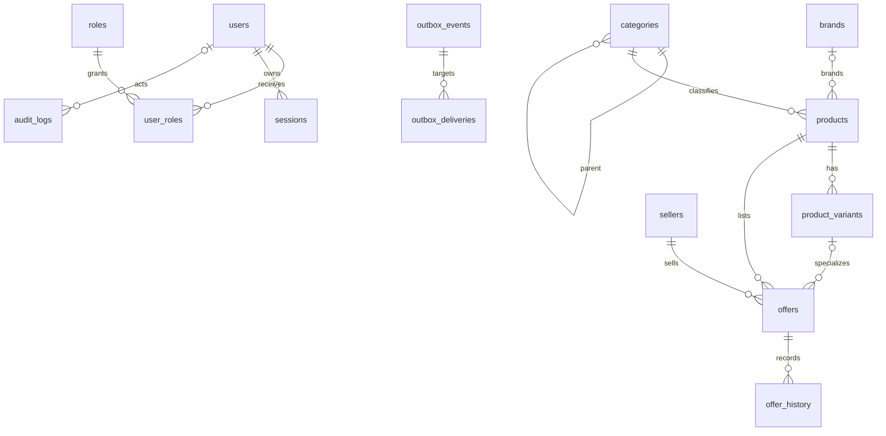

# PolyFind Phase 4 Relational Foundation

This document describes the executable schema in `migrations/001_initial_schema.sql`
through `migrations/004_relational_foundation.sql`. MySQL is the authoritative
store for catalogue, offer, identity, audit, and synchronization-queue data.

## Implemented migrations

| Migration | Implemented objects |
|---|---|
| `001_initial_schema.sql` | `categories`, `products`, `product_versions` |
| `002_catalog_indexes.sql` | Product category/price, stock, update-time, and FULLTEXT indexes |
| `003_catalog_metadata.sql` | Legacy-compatible product metadata columns |
| `004_relational_foundation.sql` | Normalized categories, brands, variants, sellers, offers, offer history, identity tables, audit logs, and outbox tables |

`product_versions` remains product-level history for compatibility with the
existing catalogue repository. It is not seller offer history. Seller-specific
price and stock history is stored in `offer_history`.

## Implemented entities and relationships

The composite foreign key `(offers.variant_id, offers.product_id)` references
`product_variants(id, product_id)`, preventing an offer from referencing a
variant belonging to another product.

## Constraints and indexes

- Stable string IDs use `VARCHAR(64)` except UUID-style user/session/event IDs,
  which use ASCII `CHAR(36)`.
- Slugs are unique for categories, brands, products, and sellers. Category and
  product slugs remain nullable at the SQL boundary so older direct writers and
  existing rows remain compatible; normal repository create operations populate
  them from the stable ID.
- Products, variants, offers, and offer history enforce positive versions.
- Prices and known stock quantities cannot be negative.
- Offer states are explicit:
  - `available`: positive stock quantity.
  - `unavailable`: zero stock quantity.
  - `unknown_stock`: `NULL` stock quantity.
- Offer validity requires `valid_until > valid_from` when an end is present.
- User-role assignments use a composite primary key.
- Outbox delivery state is independent for `redis`, `neo4j`, and `lancedb`.
- Indexes cover category hierarchy, product lifecycle, offer lookup, history,
  sessions, audit entities, pending outbox events, and delivery retries.

## Repository behavior

`RelationalRepository.createOffer` and `updateOffer` use the existing MySQL
pool and one transaction to write:

1. The offer mutation and optimistic version.
2. The corresponding `offer_history` row.
3. An `audit_logs` row.
4. An `outbox_events` row.
5. Three independent `outbox_deliveries` rows.

No synchronization worker or external Redis, Neo4j, or LanceDB adapter is
implemented in Phase 4.

## Compatibility and rollback

Migration `004` is additive and backfills category and product slugs from their
stable IDs. Existing `products.price`, `products.stock`, and
`product_versions` values are preserved. The migration runner records applied
files in `schema_migrations`; MySQL DDL rollback is not assumed. Reversal of
`004` would require a separately reviewed destructive migration and is not
provided.

## Deferred functionality

- Authentication, login, cookies, and session handling.
- Redis, Neo4j, and LanceDB connections and workers.
- Outbox polling, retries, dead-letter processing, and reconciliation.
- Public offer/category/brand/seller HTTP routes.
- Marketplace frontend changes.
